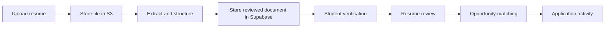

# Vistern

Vistern is a full-stack career workspace for college students pursuing technical internships. Students upload a resume, verify the parsed content, improve weak bullets, compare their background with open roles, and track progress over time.

The product was formerly named **Grasshopper Labs**. New product copy and documentation should use **Vistern**.

## Product flow

1. A student signs in with Clerk and completes role and industry preferences.
2. They upload a PDF or DOCX resume (10 MB maximum, three uploads per day).
3. The server extracts the text and asks OpenAI for structured data validated by the resume Zod schema.
4. The source file stays in S3; structured resume content and metadata go to Supabase and load through `ResumeContext`.
5. The dashboard calculates resume scores in the browser and requests version-linked XYZ-style feedback from Supabase.
6. The student can edit their master profile, restore a previous upload, match coursework, and compare their resume with live or pasted job descriptions.



## UX sprint wireframes

The current sprint is focused on making the product feel like a coherent career workspace rather than a collection of AI reports. Six connected, interactive HTML references live in [`docs/wireframes`](docs/wireframes/index.html):

- **Landing** — explains the product through one semester of visible progress.
- **Home base** — converts analytics into a short, ordered plan.
- **Resume studio** — puts feedback next to the exact line being reviewed.
- **Opportunities** — connects job-match evidence to a lightweight application pipeline.
- **Activity** — makes resume and application iteration visible over time.
- **Student profile** — holds verified projects, experience, coursework, skills, and goals.

The current and proposed experience is documented in [`docs/user-journey.md`](docs/user-journey.md). The assignment-ready first-use walkthrough is in [`docs/tutorial-user-journey.md`](docs/tutorial-user-journey.md).

Open `docs/wireframes/index.html` directly, or serve the repository with any static HTTP server. These files are design references and are intentionally separate from the production Next.js routes.

## Stack

| Layer | Technology |
| --- | --- |
| Framework | Next.js 15.5 App Router with Turbopack |
| Language | TypeScript |
| UI | React 19, Tailwind CSS 4, Radix UI/shadcn patterns, Framer Motion |
| Charts | Recharts |
| Authentication | Clerk |
| Storage | AWS S3 for resume files; Supabase Postgres for structured user data |
| AI | OpenAI structured output validated with Zod |
| File parsing | `pdf-parse` and `mammoth` |
| Deployment | Vercel |

## Important architecture rules

### Current storage boundary

Clerk remains the identity provider. S3 stores private resume file bytes; Supabase Postgres stores the master profile, structured resume documents and feedback, preferences, saved jobs, application state, settings, and usage records. The `supabase/migrations/` schema is the current application contract. Existing S3 JSON objects are read only for compatibility imports and are not the target for new writes. Use `src/lib/aws/s3.ts` for resume file access and `src/lib/supabase/` for structured data.

See [the current data hierarchy](docs/data-hierarchy.md) for the implemented tables and [the future data model](docs/future-data-model.md) for product ideas that are not yet migrations.

### The Zod schema defines resume data

`src/app/api/parse/resumeSchema.ts` is the canonical resume structure. Change it first when adding or modifying resume fields, then update dependent API and UI types.

### ResumeContext owns client resume state

`src/contexts/resume-context.tsx` loads the current resume and feedback, triggers feedback generation when needed, and exposes the shared `useResume()` hook. Dashboard and profile components should consume resume state through this context.

### Scoring is client-side

`src/lib/resumeScoring.ts` combines quantity and quality measures into category and overall scores. AI-generated XYZ feedback is stored in Supabase against the corresponding resume document. Legacy S3 feedback JSON can still be imported on first read.

## Repository map

```text
src/
├── app/
│   ├── page.tsx                  # Signed-out landing / signed-in upload
│   ├── dashboard/page.tsx        # Resume analysis dashboard
│   ├── match/page.tsx            # Live roles, match analysis, job board
│   ├── profile/page.tsx          # Master profile, statistics, history
│   ├── questionnaire/            # Student preferences
│   ├── settings/                 # Account and product settings
│   └── api/                      # Upload, parsing, analysis, structured user data
├── components/                   # Product and UI components
├── contexts/resume-context.tsx   # Shared client resume state
└── lib/                          # S3 files, Supabase data, scoring, course matching

docs/wireframes/                  # Interactive UX sprint references
```

## Local development

### Requirements

- Node.js 24.x
- npm
- Clerk, AWS, and OpenAI credentials for authenticated product flows

### Setup

```powershell
npm install
Copy-Item .env.example .env.local
npm run dev
```

Open [http://localhost:3000](http://localhost:3000).

Useful commands:

```bash
npm run dev      # Start the Turbopack development server
npm run build    # Create a production build
npm run start    # Run the production build
```

No automated test suite is currently configured. The existing `lint` script uses the removed `next lint` command and should be replaced before relying on it.

## Environment variables

Copy `.env.example` to `.env.local`. The main runtime variables are:

| Variable | Purpose |
| --- | --- |
| `NEXT_PUBLIC_CLERK_PUBLISHABLE_KEY` | Clerk browser configuration |
| `CLERK_SECRET_KEY` | Clerk server authentication |
| `OPENAI_API_KEY` | Resume parsing and analysis |
| `AWS_BUCKET_NAME` | S3 bucket |
| `AWS_BUCKET_REGION` | S3 region; server fallback is `us-east-1` |
| `IAM_AWS_ACCESS_KEY` | S3 access key |
| `IAM_AWS_SECRET_ACCESS_KEY` | S3 secret |
| `ADZUNA_APP_ID` | Live job search application ID |
| `ADZUNA_APP_KEY` | Live job search application key |
| `OWNER_CLERK_USER_ID` | Optional development/owner rate-limit bypass |

Never commit `.env` or `.env.local`.

## Main API routes

| Route | Purpose |
| --- | --- |
| `POST /api/upload` | Validate and store a source resume; enforce daily limits |
| `POST /api/parse` | Extract text, structure it with OpenAI, and save JSON |
| `GET/POST /api/resume` | Read or update the current parsed resume |
| `GET/POST /api/resume-submissions` | List and manage version history |
| `POST /api/resume-submissions/restore` | Restore a previous resume |
| `POST /api/analyze/xyz-batch` | Generate and cache bullet feedback |
| `POST /api/match-coursework` | Match parsed courses against the UF catalog |
| `GET /api/match-live` | Fetch live job matches |
| `POST /api/match` | Compare a resume and job description |
| `POST /api/tailor-resume` | Generate a role-specific resume revision |
| `GET/POST /api/job-board` | Persist saved roles and application stages |

API routes authenticate with Clerk and generally return `{ success, data?, error? }`.

## Guardrails

- Maximum upload size: 10 MB
- Daily upload limit: 3 per user, unless owner bypass is configured
- Submission history: last 10 uploads
- Restoring a version does not create a new submission statistic
- UF course matching is preference-gated
- Keep schema changes in reviewed, versioned Supabase migrations; keep future product concepts separate until the student journeys are agreed
