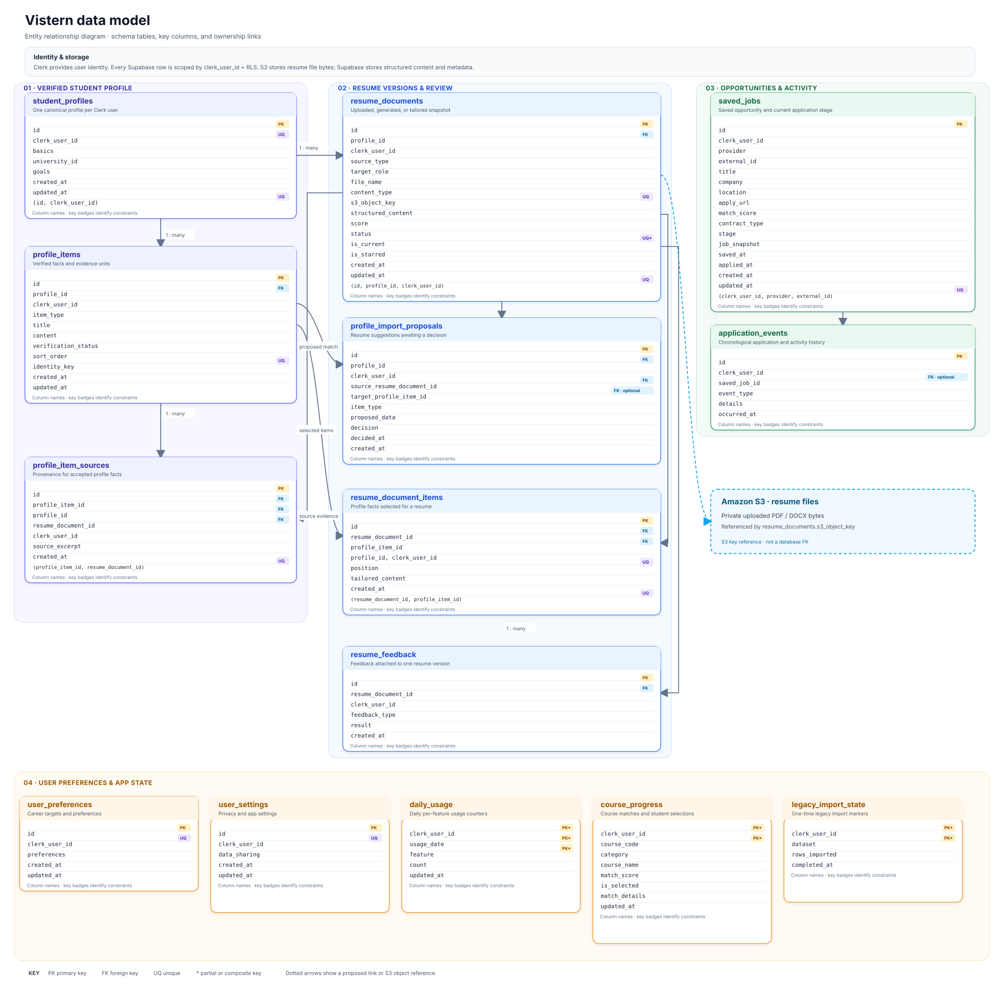

# Vistern data hierarchy and schema

**Status: current application schema.** This describes the database schema in the four migrations currently in `supabase/migrations/`. It is the implementation contract for the S3-resume-file / Supabase-structured-data cutover, not the complete model for future Career and Community features. See [future-data-model.md](future-data-model.md) for the separate planning model inspired by the newer student prototype; that document does not authorize migrations or imply its features are implemented.

Clerk remains the identity provider. The application stores Clerk's stable subject in `clerk_user_id`; there is no mirrored Clerk user table. Supabase user tables apply row-level security using that subject.

## Relationship overview

The ER diagram is available as a scalable image with color-coded table groups and room for the attributes:

The canonical path is **Clerk user → student profile → profile items**. A resume is a separate, versioned snapshot. Resume parsing creates proposals; accepting a proposal verifies or updates a profile item and records its source. Resume documents can reference selected profile items through `resume_document_items`, preserving exactly which facts and tailored wording were used. `student_profiles.basics` is user-managed contact information; Clerk email is not copied into it automatically.

Dotted links in the diagram show a proposed profile match or an S3 object key, not a database foreign key. S3 holds resume file bytes; Supabase holds structured resume content and metadata. Legacy S3 JSON remains read-only during first-access imports and is not used for new writes.

## Attributes and constraints

`PK` = primary key, `FK` = foreign key, `UQ` = unique. `NOT NULL` is stated explicitly; fields without it are nullable. `now()` and generated UUID defaults are database defaults. JSON types are `jsonb`.

### Identity and canonical profile

#### `student_profiles` — one per Clerk user

| Attribute | Definition |
| --- | --- |
| `id` | UUID PK, generated |
| `clerk_user_id` | text NOT NULL, UQ; Clerk JWT `sub` |
| `basics` | jsonb NOT NULL, default `{}`, must be an object; user-managed name, email, phone, location, LinkedIn, GitHub, portfolio |
| `university_id` | text, nullable; university/catalog key |
| `goals` | jsonb NOT NULL, default `[]`, must be an array |
| `created_at`, `updated_at` | timestamptz NOT NULL, default `now()` |
| Composite owner key | UQ (`id`, `clerk_user_id`) supports same-owner foreign keys |

#### `profile_items` — independently verifiable profile facts

| Attribute | Definition |
| --- | --- |
| `id` | UUID PK, generated |
| `profile_id` | UUID NOT NULL, FK to `student_profiles(id, clerk_user_id)`, cascade delete |
| `clerk_user_id` | text NOT NULL, owner and part of composite FKs |
| `item_type` | text NOT NULL; one of `experience`, `project`, `education`, `skill`, `certification`, `achievement`, `publication`, `extracurricular` |
| `title` | text NOT NULL; display title for the item |
| `content` | jsonb NOT NULL, default `{}`, must be an object; typed details corresponding to the item type |
| `verification_status` | text NOT NULL, default `pending`; `pending`, `verified`, or `archived` |
| `sort_order` | integer NOT NULL, default `0` |
| `identity_key` | text NOT NULL; stable item identity; UQ (`profile_id`, `clerk_user_id`, `item_type`, `identity_key`) |
| `created_at`, `updated_at` | timestamptz NOT NULL, default `now()` |
| Composite owner keys | UQ (`id`, `profile_id`, `clerk_user_id`) and (`id`, `clerk_user_id`) |

#### `profile_item_sources` — provenance for profile facts

| Attribute | Definition |
| --- | --- |
| `id` | UUID PK, generated |
| `profile_item_id`, `profile_id`, `clerk_user_id` | NOT NULL; composite FK to the same user's `profile_items`, cascade delete |
| `resume_document_id` | UUID NOT NULL; composite FK to a resume belonging to the same profile/user, cascade delete |
| `source_excerpt` | text, nullable; supporting excerpt |
| `created_at` | timestamptz NOT NULL, default `now()` |
| Constraint | UQ (`profile_item_id`, `resume_document_id`) |

### Resume documents and review

#### `resume_documents` — uploaded, generated, or tailored resume snapshot

| Attribute | Definition |
| --- | --- |
| `id` | UUID PK, generated |
| `profile_id`, `clerk_user_id` | NOT NULL; composite FK to `student_profiles`, cascade delete |
| `source_type` | text NOT NULL; `uploaded`, `generated`, or `tailored` |
| `target_role` | text, nullable |
| `file_name` | text, nullable |
| `content_type` | text, nullable; PDF, DOC, DOCX, or plain text |
| `s3_object_key` | text, nullable; required when `source_type = 'uploaded'`; unique when non-null |
| `structured_content` | jsonb NOT NULL, default `{}`, must be an object; immutable content snapshot by product convention |
| `score` | smallint, nullable, constrained to 0–100 |
| `status` | text NOT NULL, default `ready`; `draft`, `ready`, or `archived` |
| `is_current` | boolean NOT NULL, default `false`; partial UQ permits one current document per Clerk user |
| `is_starred` | boolean NOT NULL, default `false` |
| `created_at`, `updated_at` | timestamptz NOT NULL, default `now()` |
| Composite owner keys | UQ (`id`, `profile_id`, `clerk_user_id`) and (`id`, `clerk_user_id`) |

#### `profile_import_proposals` — proposed profile changes awaiting a decision

| Attribute | Definition |
| --- | --- |
| `id` | UUID PK, generated |
| `profile_id`, `clerk_user_id` | NOT NULL; FK to the same user's profile, cascade delete |
| `source_resume_document_id` | UUID NOT NULL; FK to a resume for the same profile/user, cascade delete |
| `target_profile_item_id` | UUID, nullable; points to a possible matching profile item; set null if that item is deleted |
| `item_type` | text NOT NULL; one of the supported profile item types |
| `proposed_data` | jsonb NOT NULL, must be an object; title, content, identity key, and order proposed by the parser |
| `decision` | text NOT NULL, default `pending`; `pending`, `accepted`, or `skipped` |
| `decided_at` | timestamptz, nullable |
| `created_at` | timestamptz NOT NULL, default `now()` |

#### `resume_document_items` — facts selected for a resume

| Attribute | Definition |
| --- | --- |
| `id` | UUID PK, generated |
| `resume_document_id`, `profile_id`, `clerk_user_id` | NOT NULL; composite FK to same-profile resume, cascade delete |
| `profile_item_id` | UUID NOT NULL; composite FK to same-profile item, delete restricted while referenced |
| `position` | integer NOT NULL, >= 0; UQ (`resume_document_id`, `position`) |
| `tailored_content` | jsonb, nullable; if present, must be an object |
| `created_at` | timestamptz NOT NULL, default `now()` |
| Constraint | UQ (`resume_document_id`, `profile_item_id`) |

#### `resume_feedback` — feedback attached to a particular resume snapshot

| Attribute | Definition |
| --- | --- |
| `id` | UUID PK, generated |
| `resume_document_id`, `clerk_user_id` | NOT NULL; composite FK to same-owner resume, cascade delete |
| `feedback_type` | text NOT NULL; e.g. score, XYZ feedback, insight category |
| `result` | jsonb NOT NULL, must be an object |
| `created_at` | timestamptz NOT NULL, default `now()` |

### Opportunities and application history

#### `saved_jobs` — a saved opportunity and its current application stage

| Attribute | Definition |
| --- | --- |
| `id` | UUID PK, generated |
| `clerk_user_id` | text NOT NULL |
| `provider`, `external_id` | text NOT NULL; UQ together with `clerk_user_id` |
| `title`, `company` | text NOT NULL |
| `location`, `apply_url` | text NOT NULL, default empty string |
| `match_score` | smallint NOT NULL, default `0`, constrained 0–100 |
| `contract_type` | text, nullable |
| `stage` | text NOT NULL, default `interested`; `interested`, `applied`, `interviewing`, `offer`, or `rejected` |
| `job_snapshot` | jsonb NOT NULL, default `{}`, must be an object; captured provider details |
| `saved_at`, `created_at`, `updated_at` | timestamptz NOT NULL, default `now()` |
| `applied_at` | timestamptz, nullable |
| Composite owner key | UQ (`id`, `clerk_user_id`) for application-event FK |

#### `application_events` — chronological job/application activity

| Attribute | Definition |
| --- | --- |
| `id` | UUID PK, generated |
| `clerk_user_id` | text NOT NULL |
| `saved_job_id` | UUID, nullable; composite FK to same owner's saved job, cascade delete |
| `event_type` | text NOT NULL |
| `details` | jsonb NOT NULL, default `{}`, must be an object |
| `occurred_at` | timestamptz NOT NULL, default `now()` |

### User preferences and app state

#### `user_preferences`

| Attribute | Definition |
| --- | --- |
| `id` | UUID PK, generated |
| `clerk_user_id` | text NOT NULL, UQ |
| `preferences` | jsonb NOT NULL, default `{}`, must be an object |
| `created_at`, `updated_at` | timestamptz NOT NULL, default `now()` |

#### `user_settings`

| Attribute | Definition |
| --- | --- |
| `id` | UUID PK, generated |
| `clerk_user_id` | text NOT NULL, UQ |
| `data_sharing` | boolean NOT NULL, default `false` |
| `created_at`, `updated_at` | timestamptz NOT NULL, default `now()` |

#### `daily_usage` — daily per-feature rate-limit counters

| Attribute | Definition |
| --- | --- |
| `clerk_user_id` | text NOT NULL |
| `usage_date` | date NOT NULL |
| `feature` | text NOT NULL; `analyzeMatch` or `tailorResume` |
| `count` | integer NOT NULL, default `0`, >= 0 |
| `updated_at` | timestamptz NOT NULL, default `now()` |
| Primary key | (`clerk_user_id`, `usage_date`, `feature`) |

#### `course_progress` — per-user course matching/selection

| Attribute | Definition |
| --- | --- |
| `clerk_user_id` | text NOT NULL |
| `course_code` | text NOT NULL |
| `category`, `course_name` | text NOT NULL |
| `match_score` | numeric(5,2) NOT NULL, default `0`, constrained 0–100 |
| `is_selected` | boolean NOT NULL, default `false` |
| `match_details` | jsonb NOT NULL, default `{}`, must be an object |
| `updated_at` | timestamptz NOT NULL, default `now()` |
| Primary key | (`clerk_user_id`, `course_code`) |

#### `legacy_import_state` — records completed first-read imports

| Attribute | Definition |
| --- | --- |
| `clerk_user_id` | text NOT NULL |
| `dataset` | text NOT NULL; `preferences`, `settings`, `saved_jobs`, `profile`, `course_progress`, or `usage` |
| `rows_imported` | integer NOT NULL, default `0`, >= 0 |
| `completed_at` | timestamptz NOT NULL, default `now()` |
| Primary key | (`clerk_user_id`, `dataset`) |

### Relations and access rules

- Every database row is owned through its `clerk_user_id`, which must match the trusted Clerk JWT `sub` via RLS. Each table has RLS enabled; `anon` has no table access, while `authenticated` has table CRUD grants filtered by owner policies.
- Profile and resume records use composite foreign keys with `clerk_user_id` to prevent linking a resume, profile item, proposal, or feedback record across different users.
- `student_profiles` to `profile_items` and `resume_documents` is one-to-many. A profile has many resume versions, but only one may be marked `is_current` at once.
- `resume_documents` to `profile_items` is many-to-many through `resume_document_items`; `profile_item_sources` separately tracks where accepted profile facts came from.
- `saved_jobs` to `application_events` is one-to-many; each event may be standalone (`saved_job_id` null) or associated with one of that user's saved jobs.
- `user_preferences` and `user_settings` are one-to-one with a Clerk subject; usage, course, job, event, and legacy marker rows are one-to-many or composite-key records.
- The `consume_daily_usage(p_feature, p_daily_limit)` security-invoker RPC atomically increments `daily_usage` and returns `allowed`, `used`, and `remaining`. It requires the Clerk JWT subject and is executable by `authenticated` only.
- The shared university/course catalog is reference data, not user-owned. It is not represented as a per-user table in this schema.

## Current cutover boundary

The schema is applied. Structured resume saves and history, master-profile edits and import proposals, preferences, settings, saved jobs, usage, sign-in activity, resume feedback, course matches, and insights now use Supabase. Resume binaries remain in S3. Remaining S3 JSON reads are compatibility imports for users with legacy records; there are no new S3 JSON writes. Existing legacy JSON sources are kept in place for rollback and have not been bulk deleted. Shared UF course data and LaTeX previews are fetched or recomputed instead of persisted in S3.
